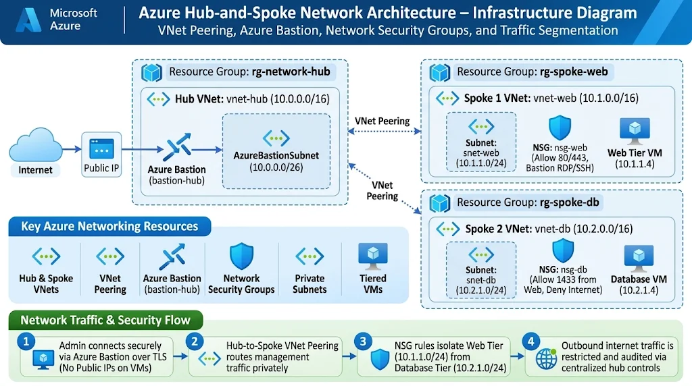

# Azure Hub-and-Spoke Network Architecture & Zero-Trust Segmentation

## 📌 Project Overview
This project demonstrates an enterprise-style **Hub-and-Spoke virtual network topology** in Microsoft Azure. It isolates application tiers across separate Virtual Networks (VNets), enforces least-privilege traffic filtering with Network Security Groups (NSGs), and removes public IP attack surfaces using **Azure Bastion**.



---

## 🏗️ Architecture & IP Addressing Plan

| Component | Resource Name | Address Space / CIDR | Purpose |
| :--- | :--- | :--- | :--- |
| **Hub VNet** | `vnet-hub` | `10.0.0.0/16` | Centralized management & secure access |
| **Bastion Subnet** | `AzureBastionSubnet` | `10.0.0.0/26` | Dedicated subnet for browser-based RDP/SSH |
| **Spoke 1 VNet (Web)** | `vnet-web` | `10.1.0.0/16` | Front-end web application workload |
| **Web Subnet** | `snet-web` | `10.1.1.0/24` | Hosts `vm-web-01` (`10.1.1.4`) |
| **Spoke 2 VNet (DB)** | `vnet-db` | `10.2.0.0/16` | Isolated back-end database tier |
| **Database Subnet** | `snet-db` | `10.2.1.0/24` | Hosts `vm-db-01` (`10.2.1.4`) |

---

## 🔒 Security Controls Implemented

1. **Zero Public IPs on Compute:** Neither `vm-web-01` nor `vm-db-01` has a Public IP address attached, eliminating brute-force RDP (3389) and SSH (22) exposure.
2. **Azure Bastion (`bastion-hub`):** Provides encrypted TLS access over port 443 directly from the Azure Portal to spoke VMs over private VNet peering.
3. **Stateful NSG Micro-Segmentation:**
   * **`nsg-web`:** Allows inbound TCP `3389`/`22` *only* from `10.0.0.0/26` (Azure Bastion) and HTTP/HTTPS (`80`/`443`).
   * **`nsg-db`:** Allows inbound TCP `1433` (SQL) *only* from `10.1.1.0/24` (Web Subnet) and management ports *only* from `10.0.0.0/26`. Denies all direct internet inbound traffic.
4. **Non-Transitive VNet Peering:** Peered `vnet-hub` ↔ `vnet-web` and `vnet-hub` ↔ `vnet-db` (with a dedicated peering link between Web and DB subnets restricted strictly to port `1433`).

---

## ✅ Verification & Testing Commands
* **Connectivity Check (Web VM $\rightarrow$ DB VM on SQL Port 1433):**
  ```powershell
  Test-NetConnection -ComputerName 10.2.1.4 -Port 1433
  # Expected Result: TcpTestSucceeded : True# azure-hub-spoke-network-security
